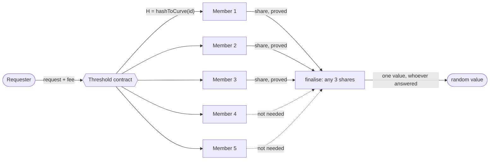

# Nightcast

**Verifiable randomness for Midnight.** Smart contracts, lotteries, games and AI agents ask for a random value and get one that nobody could choose, and that anyone can check on chain.

[](https://github.com/LearnMidnight/nightcast/actions/workflows/ci.yml)
[](https://www.npmjs.com/package/@nightcast/sdk)
[](LICENSE)

Founded by **Jack Baker**, who also founded [Lunardraw](https://lunardraw.io), whose draws and LunaSpin use it.

> **Experimental and unaudited. Testnets only.** Nothing here should secure real value yet. Read the [threat model](docs/SPEC.md#4-threat-model) for v1 and the [threat model](docs/THRESHOLD.md#threat-model) for the threshold network first.

## Two parts

| | **Nightcast v1** | **The threshold network** |
|---|---|---|
| Who answers | One oracle | A committee of up to 7 operators, any *t* of *n* (3 of 5, 4 of 7, ...) |
| Can anyone choose a value? | No: a VRF, checked by the network | No: a threshold VRF, checked by the network |
| Can anyone know a value early? | The oracle can | Only *t* members together; fewer than half of a committee can't |
| Can anyone stop a value? | The oracle can, until the deadline (it then loses collateral) | Only half a committee or more |
| Operators | One key | Cardano stake pool operators, each linked by its pool's signature, plus house seats that fill gaps |
| Admin key | None: deployed locked | None: deployed locked |
| On Preprod | Since 24 Oct 2026; v1 since 9 Nov. Answers LunaSpin every day; Lunardraw's draws embed its VRF. | Since 24 Nov 2026, for measurement. **First random value and the operators paid: 25 Nov 2026. A committee handover and the first fines: 26 Nov. All 18 calls proved: 27 Nov.** |
| Read more | [docs/SPEC.md](docs/SPEC.md) | [docs/THRESHOLD.md](docs/THRESHOLD.md) |

## The threshold network

v1's oracle can't choose an answer, but it can work out every answer before anyone else and can refuse to answer. The threshold network removes that single key holder.

Each epoch a committee is seated by the contract itself, in turn round a ring, with nothing random and nothing the caller chooses. The members run a key ceremony in which **every dealer proves its deal in zero knowledge as it posts it**, so a bad deal can't be posted and there is no complaint phase. Nobody ever holds the group key. Each member answers a request with its share, the contract checks each share against that member's share key, and any *t* shares combine into one value:



**On Preprod, 25 Nov 2026:** a 3 of 5 committee (one independent operator and four house operators) was seated, dealt by all five in 37 proved transactions, and started serving. Its first request was answered by all five and finalised from three:

```
b353bce170e69d9cb1ecfe1247748508485a3f22adcf751057d831c1fb42e5b5
```

The test also works the value out off chain from the dealers' polynomials (which only a test holds together), and the two match. After the request's deadline the contract settled it and paid the five members that answered in time: 0.08 tNIGHT each from the 0.5 tNIGHT fee (0.1 went to whoever finalised), collected by each with its own `claim`. No bond was touched.

**26 Nov 2026:** after its 10-hour epoch, the committee handed over to a new one with a fresh key, reviewed and opened by the contract itself. Then a request that only two of the five answered: after its deadline the contract voided it, returned the fee, and fined only the three silent seats, one slot of bond each. A late third answer still produced the request's one value, so staying silent bought nobody a different value. Later the same day epoch 3 took over, operators topped up and withdrew bond, and two committees in a row recorded a recommended successor: That night an operator whose bond had fallen below the minimum was stood down, and on 27 Nov the contract sized the next committee without it, 3 of 4, before the operator topped up and rejoined. **All 18 of the contract's calls have now run with real proofs on Preprod.**

Contract `46d0489c7df03401e7b737f8e8bfa4e9535c55a8994dcf26f217da4e999b1ead`; this deployment uses short epochs and test pool keys, and will be replaced.

The design, committee sizes, money, the pool list, the threat model and the measured proof times and fees are in **[docs/THRESHOLD.md](docs/THRESHOLD.md)**. The contract is [`network/threshold/src/threshold-net.compact`](network/threshold/src/threshold-net.compact), with 224 in-memory checks in [`net-check.mjs`](network/threshold/check/net-check.mjs).

## Nightcast v1: one oracle, live since October

It works like [Chainlink VRF](https://docs.chain.link/vrf): you request randomness, an oracle answers, and the answer comes with a proof. On Midnight the proof is the transaction itself. The oracle's `fulfil` circuit evaluates the VRF with its secret key as a private input, so the network only accepts the one output that key can produce for that request, and the key is never revealed.

```
requester                        Nightcast contract                          oracle
    |  request(tag, seed, deadline)   |                                           |
    |-------------------------------->|  id = SHA(addr, requester, tag, seed)     |
    |                                 |  H = hashToCurve(id), key = oracleKey     |
    |                                 |  status = pending                         |
    |                                 |<------------------------------------------|  watches for pending ids
    |                                 |  fulfil(id), proving in ZK that:          |
    |                                 |    G·sk == request key                    |
    |                                 |    output = SHA(H·sk)                     |
    |  read requests[id].output       |  status = fulfilled                       |
    |<--------------------------------|                                           |
```

- **The oracle can't choose:** one key and one request give exactly one output. Its only power is to not answer.
- **Unpredictable:** computing the output needs the oracle's secret key.
- **Checked on chain:** the network verifies the proof before storing the output, and everything a consumer derives from it can be recomputed from public data.
- **Withholding costs something:** every request has a deadline and pays a fee, and holds a slot of the oracle's bond. If the oracle misses the deadline, anyone can `expire` the request and the requester gets the fee and the collateral back.
- **Your ids are yours:** request ids include the requester's commitment, so nobody else can claim, burn or spoof them.

| Network | Contract | |
|---|---|---|
| Preprod | `eaae909ead81a20f6a8873aec8bdcd0c428424672771991550c483b044a73adb` | **v1**, with request fees and oracle bonds. Deployed locked on 9 Nov 2026 from `9e7203e` (Compact 0.31.1); it carried over the ledger 9 fork the same day. Fee 0.1 tNIGHT and collateral 1 tNIGHT a request. |
| Preprod | `f3083513bae7010e32acac41e3f3dbfdfa0516c6ca80382c5847dd3529cf158e` | v0, retired. Still on chain; no oracle answers it. |

Anyone can check the live deployment: `./nightcast verify --network preprod` compares it with the published record, [deployments/preprod.json](deployments/preprod.json), including the SHA-256 fingerprint of every circuit's verifier key. The construction, ledger layout and threat model are in [docs/SPEC.md](docs/SPEC.md).

## Use it

```bash
npm install @nightcast/sdk @nightcast/contract
```

```ts
import { pickMany } from '@nightcast/sdk';

const winners = pickMany(output, names, 3); // three fair winners from one Nightcast answer
```

One answer gives picks, shuffles, dice, weighted prizes and lottery numbers. See the **[developer guide](docs/GUIDE.md)** and the [raffle example](examples/raffle). The packages are published from this repository by [GitHub Actions with provenance](docs/PUBLISHING.md); 0.2.0 holds the v1 contract the live deployment runs.

**For AI agents.** `./nightcast mcp` is an MCP server with tools to fingerprint a list, request a random value, check a request and turn the answer into a result (a winner, an order, dice...). It runs over stdio for an AI app on your computer, or over HTTP for agents anywhere. See [docs/MCP.md](docs/MCP.md).

**Run it yourself.** Building from source, deploying, running an oracle and checking a result end to end: **[docs/RUN-V1.md](docs/RUN-V1.md)**. New to Midnight? The step-by-step [Preprod guide](docs/preprod-guide.md) starts from nothing installed.

## Built on Nightcast

- [Lunardraw](https://github.com/LearnMidnight/Lunardraw): a self-running lottery for AI agents, with daily Starfall draws. Its contract embeds Nightcast's VRF ([SPEC §5.1](docs/SPEC.md#51-on-chain-consumers-embed-dont-call-decision-22-oct-2026)).
- [LunaSpin](https://lunardraw.io/spin/): a free name draw with a certificate anyone can check. Each spin is a request to the live v1 deployment, made through the MCP server.

## Repository

| Path | What it is |
|---|---|
| [`contract/`](contract) | The v1 contract (`nightcast.compact`), key handling, an in-memory simulator, and `NightcastWords.compact` for expanding an answer in-circuit |
| [`sdk/`](sdk) | `@nightcast/sdk`: the oracle service, chain adapters, and turning an answer into picks, shuffles, dice and lottery draws |
| [`deploy/`](deploy) | The `./nightcast` command: deploy locked, verify, wallets, the oracle's bond, run the oracle, requests, checks, the MCP server |
| [`network/threshold/`](network/threshold) | The threshold network: contract, in-memory checks, deploy and call tooling |
| [`network/`](network) | The three-operator prototype the threshold network replaced |
| [`deployments/`](deployments) | Published records of live deployments |
| [`examples/raffle/`](examples/raffle) | A fair raffle using only the published packages |
| [`docs/`](docs) | [SPEC](docs/SPEC.md) (v1), [THRESHOLD](docs/THRESHOLD.md), [GUIDE](docs/GUIDE.md), [MCP](docs/MCP.md), [RUN-V1](docs/RUN-V1.md), [Preprod guide](docs/preprod-guide.md) |

## Roadmap

1. **Threshold network on Preprod:** the remaining calls with real proofs, a second epoch, a request nobody answers. *(Now.)*
2. **The operator package** (`@nightcast/operator`, npm and Docker) and a keeper anyone can run.
3. **The real pool list** and the first independent Cardano stake pool operators on Preprod.
4. **An independent security audit** and a human cryptographer's review of the threshold design ([#15](https://github.com/LearnMidnight/Nightcast/issues/15)).
5. **Mainnet**, deployed locked ([#16](https://github.com/LearnMidnight/Nightcast/issues/16)), and Lunardraw moved to the threshold network.

## Limitations

- **Not audited.** v1 and the threshold network have been checked in memory and on Preprod, and the threshold contract has been through eight independent AI review passes, but no human cryptographer or auditor has reviewed either yet.
- **v1 has one oracle.** It can withhold an answer until the deadline and, if it can influence a request's input, grind for favourable outputs ([SPEC §4.1](docs/SPEC.md#41-grinding)). Its collateral makes withholding cost it something, up to the collateral's value.
- **The threshold network starts with house seats.** With fewer than three independent operators the house can reach the threshold alone, which is v1's trust, stated plainly. From three independents every value needs at least one of them.
- **Results are read off chain.** On-chain consumer callbacks wait for cross-contract calls on Midnight.
- **A new v1 deployment** needs the v1 contract compiled with Compact 0.36 first ([#58](https://github.com/LearnMidnight/Nightcast/issues/58)). The live one keeps working.

## Licence

[MIT](LICENSE)
