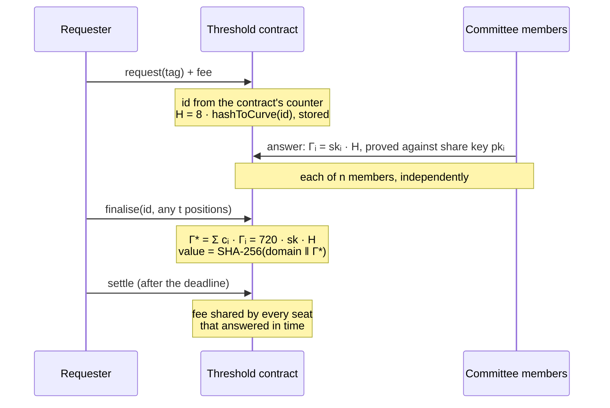

# The Nightcast threshold network

*Status: running on Preprod for measurement since 24 Nov 2026. Experimental and unaudited. Testnets only.*

Nightcast v1 has one oracle. Its answers can't be chosen (the network checks a VRF proof), but whoever holds the key can work out every answer before anyone else, and can refuse to answer. The threshold network removes that single key holder.

A **committee** of *n* operators shares one key that nobody holds. Any *t* of them produce the same random value for a request, and fewer than *t* can't work it out. **Fewer than half of a committee can neither work out a value early nor stop one.** The contract seats each committee itself, runs the key ceremony, checks every share and pays the operators. It has no admin key, and nothing in it can be changed after deployment.

The contract is [`network/threshold/src/threshold-net.compact`](../network/threshold/src/threshold-net.compact) (Compact 0.36.1, 18 circuits).

## Contents

- [On Preprod](#on-preprod)
- [How one random value is made](#how-one-random-value-is-made)
- [Epochs and the key ceremony](#epochs-and-the-key-ceremony)
- [Committee sizes](#committee-sizes)
- [Who can be an operator](#who-can-be-an-operator)
- [Fees, bonds and penalties](#fees-bonds-and-penalties)
- [Rules for consumers](#rules-for-consumers)
- [Threat model](#threat-model)
- [Measurements](#measurements)
- [Circuits](#circuits)
- [Reviews, and what is still open](#reviews-and-what-is-still-open)

## On Preprod

| | |
|---|---|
| Contract | `46d0489c7df03401e7b737f8e8bfa4e9535c55a8994dcf26f217da4e999b1ead` |
| Deployed | 24 Nov 2026, locked (its maintenance authority was replaced by an empty committee after the last verifier key was added) |
| Purpose | Measuring real proofs, fees and transaction limits. Short epochs, small numbers, and **test pool keys** that we generated, not real stake pools. It will be replaced. |
| Epoch 1 | 3 of 5: one independent operator and four house operators. Seated, dealt by all five, serving since 25 Nov 2026 08:35 UTC. |
| First value | Request `5b2e35b1…ae770`, answered by all five, finalised from positions 1, 2 and 3: `b353bce170e69d9cb1ecfe1247748508485a3f22adcf751057d831c1fb42e5b5`. The test also computes the value off chain from the dealers' polynomials (which only a test holds together); the two match. |

## How one random value is made

1. **Request.** A consumer calls `request(tag, now, refundTo)` and pays the fee. The id comes from the contract's own counter, so a requester can't try ids until it likes one. The contract maps the id to a curve point *H* once and stores it.
2. **Answer.** Each member *i* posts Γᵢ = skᵢ·H. The circuit proves the share was made with the same secret as that member's share key on chain, so a wrong or copied share is refused. Answers don't wait for each other.
3. **Finalise.** Once *t* answers are in, anyone calls `finalise` with any *t* positions. The contract combines them with Lagrange coefficients and hashes the result into the value: `SHA-256("nightcast:threshold:v1" ‖ Γ*)`. Whoever sends it earns a bounty from the fee.
4. **Settle.** After the deadline anyone calls `settle`. If at least *t* members answered in time, they share the fee. Otherwise the request is void: the fee goes back, and the members that missed lose a slice of bond.

Any *t* shares combine to the same point, so the value doesn't depend on who answers or in what order:

$$\sum_{i \in S} c_i\,\Gamma_i = 720 \cdot sk \cdot H, \qquad c_i = 720 \prod_{j \in S,\ j \neq i} \frac{j}{j - i}$$

*S* is any set of *t* positions and *sk* is the key nobody holds. 720 = 6! makes every coefficient a whole number for positions 1 to 7, so one rule serves every committee size.

A void request keeps its *H* and can still be answered and finalised later. Staying silent never buys a different value.

## Epochs and the key ceremony

Time is cut into epochs. Each epoch has one committee with a fresh key, made by a distributed key generation in which **every dealer proves its deal as it posts it**. A bad deal can't be posted, so there is no complaint phase, and nobody can be removed by a made-up complaint.

1. **Open** (`openEpoch`): allowed once the serving committee has served its epoch length, or the last ceremony failed. The contract reviews the outgoing committees first, and stands down any operator that missed too often or whose bond is too low. Then it sizes the next committee from who is active.
2. **Seat** (`seat`): independent operators take the next places round a ring, starting after the one seated last; house operators fill the rest in turn. The sender chooses nothing, and nothing is random. A random pick could be steered by a colluding majority; a ring in a fixed order can't.
3. **Deal** (`dealCommit`, `dealShare`): each seat commits to a degree *t−1* polynomial (`dealCommit`) and posts one encrypted share for every seat (`dealShare`). The circuit proves each commitment and each share is correct. A share is encrypted to the receiving seat's key with a pad from SHA-256 of a Diffie-Hellman point.
4. **Finish** (`finish`): when every seat has dealt, or at the deadline with at least *t* finished, the contract adds up the finished dealers' commitments into the group key and the share keys, and the committee starts serving. With fewer than *t*, the ceremony has failed and the serving committee carries on.

Rules that came out of the reviews:

- Seating and dealing each have a fixed length. Nobody chooses a deadline.
- Nobody joins the ring, leaves, is revoked or is stood down while a committee is being seated, so a committee that was sized can always be filled by the operators it was sized for.
- A seat that hasn't finished dealing by the deadline loses part of its bond. If the ceremony failed although at least one dealer finished, the seats that didn't are stood down too, so they can't fail the next one.
- A request belongs to the committee serving when it was made, and that committee can still answer it after it is replaced. A committee that has served four epoch lengths takes no new requests.
- The first epoch can be 1 of 1, a single house seat: exactly today's single oracle.

## Committee sizes

The sizes are 1 of 1, 3 of 4, 3 of 5, 4 of 6 and 4 of 7, chosen by the contract from who is active. One rule sets every size: fewer than half of a committee's seats can neither work out a value nor stop one. A second rule sits beside it: the number of independent pools it takes to work out a value never drops because the house is away.

Rows are active independent operators, columns active house operators. "None" means no new committee opens and the serving one carries on.

| Independents | 0 house | 1 house | 2 house | 3 house | 4 house |
|---|---|---|---|---|---|
| 0 | none | 1 of 1 | 1 of 1 | 1 of 1 | 1 of 1 |
| 1 | none | 1 of 1 | 1 of 1 | 3 of 4 | 3 of 5 |
| 2 | none | 1 of 1 | 3 of 4 | 3 of 5 | 3 of 5 |
| 3 | none | 3 of 4 | 3 of 5 | 3 of 5 | 3 of 5 |
| 4 | none | none | 4 of 6 | 4 of 7 | 4 of 7 |
| 5 | none | 4 of 6 | 4 of 7 | 4 of 7 | 4 of 7 |
| 6 | 4 of 6 | 4 of 7 | 4 of 7 | 4 of 7 | 4 of 7 |
| 7 or more | 4 of 7 | 4 of 7 | 4 of 7 | 4 of 7 | 4 of 7 |

- **House operators** are the project's own. Their four keys are fixed in the contract at deployment, so everyone can see which seats are the house's. The house only fills seats that independents can't.
- **Stated plainly:** with fewer than three independents, the house can reach the threshold alone, so it could know values early. That is today's trust, the same as v1. From three independents every value needs at least one of them, and from seven the house has no seat at all.
- The network keeps running with one house operator away in every case, and with two away in most. It needs six independent pools to run with no house at all.

## Who can be an operator

An independent operator is one that a listed Cardano stake pool has signed for, and the contract checks that signature itself. The point is that operators are really different people: one person holding many seats breaks the threshold.

**The pool list.** The contract can't read Cardano, and without a list anyone could make keys and call them pools. So the contract is deployed with a commitment to a list of pool keys (a SHA-256 chain over batches of eight), and anyone loads the batches afterwards with `loadPools`. Only the committed batches are accepted, anyone can rebuild the list from Cardano and compare, and a pool's place in the list is its operator's place in the ring.

**Who is on it.** A pool qualifies if it produces blocks on Cardano, has minted blocks, has been registered for at least six months, and runs a Midnight block producer. Midnight's block production isn't open to stake pools yet (on Preprod, 24 Nov 2026: 13 permissioned producers, no registered stake pools), so the list is made in two steps: the first real deployment uses the Cardano half of the rule, and the one after it adds the Midnight requirement.

**Linking** (`linkPool`). The pool's Ed25519 cold key signs a 32-byte message naming this contract, the operator, the pool's running count, link or revoke, and an expiry. The operator brings the signature itself, so no pool can claim an operator that didn't ask. Anyone may bring a revocation, which stands the operator down. A pool backs one operator at a time, and after its operator leaves it waits two epoch lengths before backing another. Checking the Ed25519 signature inside a proof is the largest circuit by far (a 302 MB prover key), but it runs once per link.

## Fees, bonds and penalties

The project takes nothing from the network and holds none of its money.

- **Fees.** The requester pays one fixed fee. Whoever finalises in time earns a fixed bounty from it. The rest is shared equally by every seat that answered before the deadline, whichever answers were combined, so answering fast can't shut others out. Operators collect with `claim`.
- **Bond.** Counted in slots of a fixed size, with a minimum to register. Anyone can add to an operator's bond (`topUp`). A seat whose committee is in a ceremony or serving can't withdraw; its bond is released once the committee is replaced.
- **Penalties** stay in the contract and are paid to nobody, so nobody gains from another's failure.

| Fault | Provable? | What happens |
|---|---|---|
| Dealing a bad share | It can't be posted | Nothing to penalise |
| Not finishing dealing by the deadline | Yes | Ceremony penalty; stood down if the ceremony failed and another dealer finished |
| Not answering a request that goes void | Yes | Miss penalty for that request |
| Missing in more answering windows than allowed | Yes | Stood down when the next epoch opens, then sits out two epoch lengths |
| Bond below the minimum | Yes | Anyone can stand it down (`standDown`) |
| Its pool revokes it | Yes | Stood down |
| Telling others its share, or colluding | No | Nothing the contract can see. This is what the threshold and the pool link are for. |

A miss is counted once per answering window, however many requests that window held, so a burst of requests can't stand a seat down. Every number (epoch length, windows, fee, bond, penalties) is set at deployment and can't be changed, and the constructor refuses unsafe combinations, such as a miss penalty worth less than the fee.

## Rules for consumers

- **Commit before you ask.** A value is public as soon as *t* answers are on chain, before anyone finalises. Ticket sales, bets and anything else the value decides must close before the request is made.
- **Never ask twice for the same draw.** A void request keeps its value and can be finalised later. A second request would be a second roll, which is exactly what a silent operator would want.

## Threat model

Everything rests on one assumption: fewer than half the seats of a committee work together.

| Attack | What it gets | What stops or limits it |
|---|---|---|
| *t* or more members collude | They know each value before it's published. They can't choose it. | The pool link, bonds, seats in list order. Collusion can't be proven, so it can't be penalised; consumers commit before they ask. |
| Half a committee or more stays silent | Requests go void; values come late or not at all | Miss penalties, then stand-downs with a sit-out. A void request keeps its value, so silence buys no second roll. |
| Seats that never deal | A failed ceremony | A fine each time; stood down if the ceremony fails, and the next committee is sized without them |
| One person behind many pools | A cheap route to *t* | The pool list rule (six months on Cardano, minted blocks, a Midnight block producer). The weakest point: a large operator can run several qualifying pools. |
| Joining just before an epoch opens | The choice of epoch, never more seats | Places follow the list, not the moment of joining; nobody joins during seating |
| The requester tries many tags | Nothing | Ids come from the contract's counter, and values need the key |
| A chain access point lies or stalls | Stale or false readings; it can't forge a transaction | Read from two or three and compare |
| Midnight's block producers censor or reorder | Delays, which can turn into misses | Outside this design |
| A bug in the circuits or the ceremony | Anything | Eight review passes, 224 in-memory checks, the Preprod run, and a human cryptographer before Mainnet |

## Measurements

Real proofs on Preprod, 24 and 25 Nov 2026 (proof server 9.0.2 on an 8-vCPU VM, peak memory 4.0 to 4.8 GiB; `linkPool` 4.9 GiB).

| Call | Proof | Whole call | Transaction | Fee |
|---|---|---|---|---|
| `linkPool` | 80 to 103 s | | | |
| `openEpoch` | 7.2 s | 31 s | 14.5 KB | |
| `seat` | 1.6 to 2.5 s | 25 to 31 s | 18.8 to 21.9 KB | |
| `dealCommit` | 2.8 to 3.6 s | 27 to 30 s | 17.8 KB | 0.63 DUST |
| `dealShare` | 15 to 32 s | 40 to 59 s | 16.6 to 20.6 KB | 0.50 to 0.64 DUST |
| `finish` | 7.4 s | 36 s | 14.4 KB | 0.47 DUST |
| `request` | 20.8 s | 54 s | 17.1 KB | 0.74 DUST |
| `answer` | 3.3 to 6.1 s | 29 to 34 s | 15.1 KB | 0.50 DUST |
| `finalise` | 21.3 s | 47 s | 17.5 KB | 0.73 DUST |

A 3 of 5 ceremony is 37 calls and took about 25 minutes of calls from one wallet. One request with five answers and a finalise took 5 minutes.

**Fee payment.** Ledger 9 allows a transaction 2 µs of checking per byte (at least 15 ms). Our transactions are paid with three DUST spends: `openEpoch` with one spend was refused (19.6 ms against 16.8 ms allowed at 8,415 bytes), even with the client versions that were meant to fix this ([midnight-ledger#838](https://github.com/midnightntwrk/midnight-ledger/issues/838)). Each extra spend adds about 3 KB, which raises the allowance by more than the spend costs.

## Circuits

| Group | Circuits |
|---|---|
| Registry | `register`, `topUp`, `leave`, `withdraw`, `standDown`, `claim` |
| Pool list | `loadPools`, `linkPool` |
| Epochs | `openEpoch`, `seat`, `dealCommit`, `dealShare`, `finish` |
| Requests | `request`, `answer`, `finalise`, `settle` |
| Successor | `recommend`: records an address that two-thirds of a committee name in two served epochs in a row. It moves nothing; operators and consumers move by their own choice. |

Files:

| Path | What it is |
|---|---|
| [`network/threshold/src/threshold-net.compact`](../network/threshold/src/threshold-net.compact) | The contract |
| [`network/threshold/check/net-check.mjs`](../network/threshold/check/net-check.mjs) | 224 in-memory checks of every rule above, on the compiled contract (`bash network/threshold/check/run-net.sh`) |
| [`network/threshold/ops/`](../network/threshold/ops) | Deploy (`deploy.mjs`), keys (`keys.mjs`), and every call with timing and transaction reports (`ops.mjs`) |
| [`network/threshold/vm/tnet.sh`](../network/threshold/vm/tnet.sh) | The Preprod test, as run |
| `network/threshold/src/*-probe.compact` | Small contracts that checked the building blocks first: hash to curve, Ed25519 in a circuit, a proved deal |

## Reviews, and what is still open

The design was reviewed once and the contract eight times by independent AI review passes, each with no knowledge of the work being reviewed. The first four found 1 Critical and 6 High issues, all fixed; the last four found none. **No human cryptographer has checked it yet**, and nothing here is safe to rely on until one has.

Notes for that review:

- Midnight's `hashToCurve` can have more than one valid output for an input, so *H* is worked out once, by `request`, stored, and multiplied by 8 to clear any small-order part.
- Everything kept in the ledger is hashed with `persistentHash` (SHA-256); Midnight says `transientHash` may change between upgrades.
- A dealt share is hidden with a pad made from two SHA-256 outputs of the Diffie-Hellman point (255 bits measured; a share is up to 252).

Still to do, in order:

1. The remaining calls with real proofs: `settle`, `claim`, a second epoch, a request nobody answers.
2. A contract stage for what Preprod shows (in-flight proofs made out of date by other dealers finishing, or by `finalise`), and the small items the last reviews listed.
3. The `@nightcast/operator` package (npm and Docker), and a keeper that sends the transactions that move an epoch along.
4. The real pool list and the first independent stake pool operator on Preprod.
5. A human cryptographer's review ([#15](https://github.com/LearnMidnight/Nightcast/issues/15)), a condition for Mainnet.
6. Lunardraw's Starfall and LunaSpin move to the network.
